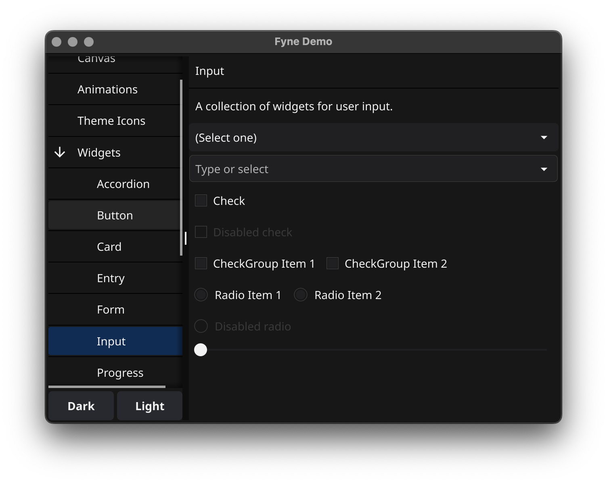
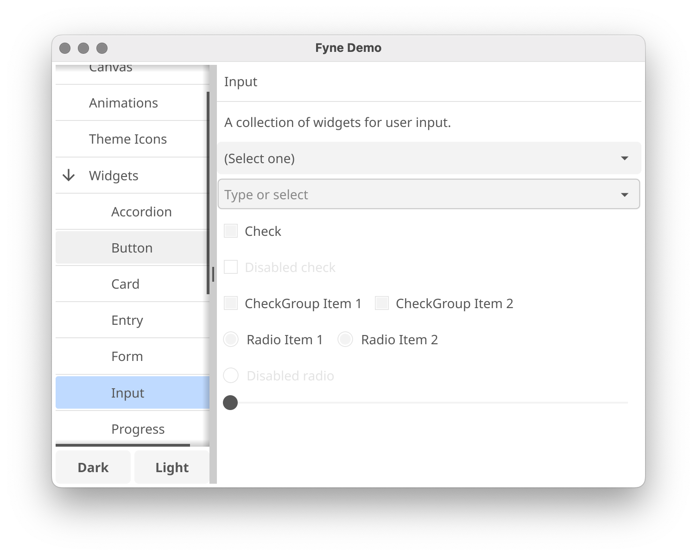
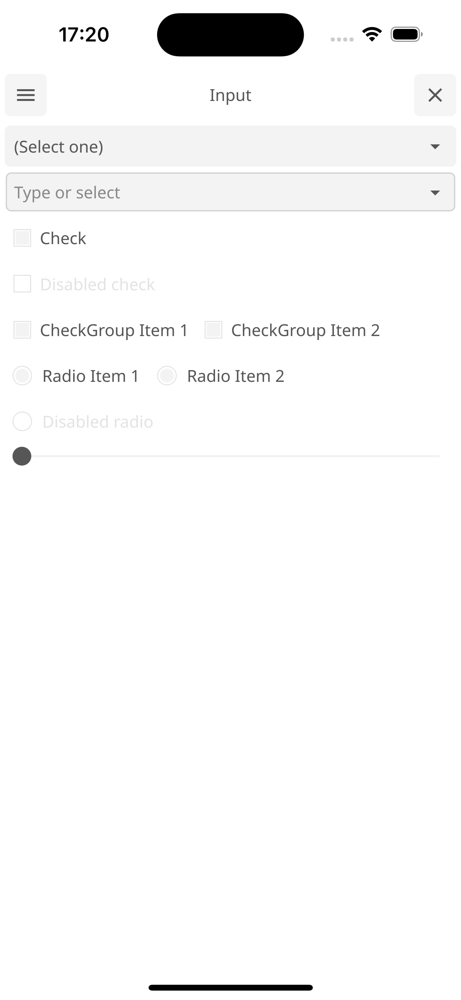
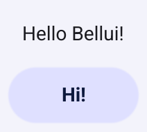
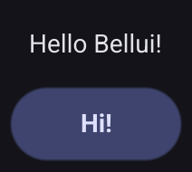

# About

**Bellui** is an easy-to-use UI toolkit and app API written in Go, for building
applications that run on desktop and mobile devices from a single codebase.

Bellui began as a fork of the [Fyne](https://fyne.io) toolkit and diverges
substantially from it; it is not intended to merge back. Highlights: a Material Design 3 theme system and component set, a
reworked package architecture (`geo`/`event`/`core` as the source of truth for
fundamental types), goroutine-safe widget APIs, and a GL rendering engine with
canvas FBO, shadows, stencil clipping, and 3D support. See `docs/notes/`
(per-area design detail) and `ROADMAP.md` for details.
Module path: `github.com/belluikit/bellui`

# Prerequisites

To develop apps using Bellui you will need Go version 1.25 or later, a C compiler and your system's development tools.
If you're not sure if that's all installed or you don't know how then check out our
[Getting Started](https://bellui.com/develop/) document.

> **Rendering backend:** this fork renders with **WebGPU** by default (Metal /
> Vulkan / D3D12 / browser WebGPU). The legacy OpenGL/GLES/WebGL backend remains
> available with the `gl` build tag (`go build -tags gl ...`). See
> [docs/webgpu.md](docs/webgpu.md) for build requirements and the platform matrix.

Using the standard go tools you can install Bellui's core library using:

    go get github.com/belluikit/bellui@latest

After importing a new module, run the following command before compiling the code for the first time. Avoid running it before writing code that uses the module to prevent accidental removal of dependencies:

    go mod tidy

# Widget demo

To run a showcase of the features of this fork, build the MD3 gallery from
the sibling repository:

    git clone https://github.com/belluikit/gallery.git
    cd gallery && go run .

And you should see something like this (after you click a few buttons):

<p align="center" markdown="1" style="max-width: 100%">
  
</p>

Or if you are using the light theme:

<p align="center" markdown="1" style="max-width: 100%">
  
</p>

And even running on a mobile device:

<p align="center" markdown="1" style="max-width: 100%">
  
</p>

# Getting Started

Bellui is designed to be really easy to code with.
If you have followed the prerequisite steps above then all you need is a
Go IDE (or a text editor).

Open a new file and you're ready to write your first app!

```go
package main

import (
	"github.com/belluikit/bellui/app"
	"github.com/belluikit/bellui/container"
	"github.com/belluikit/bellui/widget"
)

func main() {
	a := app.New()
	w := a.NewWindow("Hello")

	hello := widget.NewLabel("Hello Bellui!")
	w.SetContent(container.NewVBox(
		hello,
		widget.NewButton("Hi!", func() {
			hello.SetText("Welcome :)")
		}),
	))

	w.ShowAndRun()
}
```

And you can run that simply as:

    go run main.go

> [!NOTE]  
> The first compilation of Bellui on Windows _can_ take up to 10 minutes, depending on your hardware. Subsequent builds will be fast.

It should look like this:

<div align="center">
  <table cellpadding="0" cellspacing="0" style="margin: auto; border-collapse: collapse;">
    <tr style="border: none;"><td style="border: none;">
      
    </td><td style="border: none;">
      
    </td></tr>
  </table>
</div>

## Run in mobile simulation

There is a helpful mobile simulation mode that gives a hint of how your app would work on a mobile device:

    go run -tags mobile main.go

Another option is to use `bellui` command, see [Packaging for mobile](#packaging-for-mobile).

# Installing

Using `go install` will copy the executable into your go `bin` dir.
To install the application with icons etc into your operating system's standard
application location you can use the bellui utility and the "install" subcommand.

    go install github.com/belluikit/bellui/cmd/bellui@latest
    bellui install

# Packaging for mobile

To run on a mobile device it is necessary to package up the application.
To do this we can use the bellui utility "package" subcommand.
You will need to add appropriate parameters as prompted, but the basic command is shown below.
Once packaged you can install using the platform development tools or the bellui "install" subcommand.

    bellui package -os android -appID my.domain.appname
    bellui install -os android

The built Android application can run either in a real device or an Android emulator.
However, building for iOS is slightly different.
If the "-os" argument is "ios", it is build only for a real iOS device.
Specify "-os" to "iossimulator" allows the application be able to run in an iOS simulator:

    bellui package -os ios -appID my.domain.appname
    bellui package -os iossimulator -appID my.domain.appname

# Preparing a release

Using the bellui utility "release" subcommand you can package up your app for release
to app stores and market places. Make sure you have the standard build tools installed
and have followed the platform documentation for setting up accounts and signing.
Then you can execute something like the following, notice the `-os ios` parameter allows
building an iOS app from macOS computer. Other combinations work as well :)

    $ bellui release -os ios -certificate "Apple Distribution" -profile "My App Distribution" -appID "com.example.myapp"

The above command will create a '.ipa' file that can then be uploaded to the iOS App Store.

# Documentation

More documentation is available at the [Bellui website](https://bellui.com/) or on [pkg.go.dev](https://pkg.go.dev/github.com/belluikit/bellui?tab=doc).

# Examples

The [Bellui gallery](https://github.com/belluikit/gallery) is a Material Design 3
showcase covering every widget, theme and rendering feature in the toolkit — use it
to explore the API and to manually verify changes.

# Shipping the Bellui Toolkit

All Bellui apps will work without pre-installed libraries, this is one reason the apps are so portable.
However, if looking to support Bellui in a bigger way on your operating system then you can install some utilities that help to make a more complete experience.

## Additional apps

It is recommended that you install the following additional apps:

| app           | go install                          | description                                                            |
| ------------- | ----------------------------------- | ---------------------------------------------------------------------- |
| bellui_settings | `github.com/belluikit/bellui/cmd/bellui_settings` | A GUI for managing your global Bellui settings like theme and scaling    |

These are optional applications but can help to create a more complete desktop experience.
